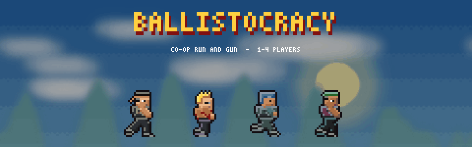
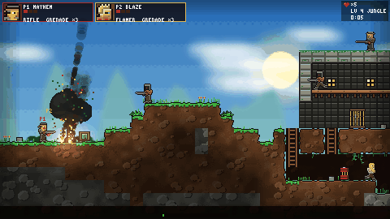
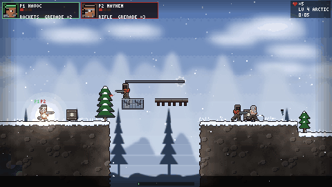
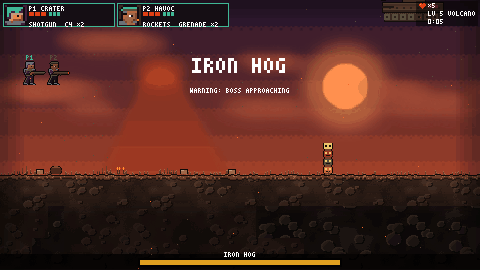

<p align="center">
  
</p>

<h1 align="center">💥 BALLISTOCRACY 💥</h1>

<p align="center">
  <b>An 80s pixel-art co-op run'n'gun that runs in your browser.</b><br>
  Blow up the map, free the prisoners, take down the bosses: alone, on one screen with up to 4 friends, or online.
</p>

<p align="center">
  <a href="https://d0kray.github.io/ballistocracy/"><b>▶ PLAY NOW IN YOUR BROWSER</b></a>
  &nbsp;·&nbsp; desktop and mobile &nbsp;·&nbsp; no install, no account
</p>

<p align="center">
  <a href="https://d0kray.github.io/ballistocracy/"></a>
  
  <a href="LICENSE"></a>
</p>

## Gameplay

<p align="center">
  <br>
  <i>Two-player co-op in the jungle: run, jump, shoot, throw grenades.</i>
</p>

<p align="center">
  <br>
  <i>Every explosion digs into the terrain. Watch your step (and your own rockets).</i>
</p>

<p align="center">
  <br>
  <i>Every 5th level ends in a boss arena: here the IRON HOG tank on the volcano.</i>
</p>

## Features

- Procedural levels in six biomes (jungle, desert, arctic, ruined city, industrial, volcano), each with a playlist of three tracks in different styles (drum and bass, funk, surf rock, stoner rock, trance, orchestral, thrash, darksynth, acid techno, doom and power metal, synthwave...) that rotate while you play.
- No two runs alike: every level rolls its own mix of sections, scenery and often a twist (ambush, minefield, prison camp, sniper alley, dog pack and more). Even level 1 changes from run to run.
- Destructible terrain: rockets, grenades, C4 and barrels tear the map apart, and loose chunks fall.
- Three bosses, enemies that alert each other, traps, weapons, power-ups and prisoners to free.
- Local co-op for 1–4 players (two keyboard halves plus gamepads) and online co-op over peer-to-peer.
- Mouse aiming on PC, touch controls with drag-to-aim on phones.
- Progress is saved in your browser, so you can continue where you stopped.
- Built-in level editor and community levels.

The main menu opens with an EDM title song where a synthesized robot voice (formant synthesis, no samples) sings BAL-LIS-TO-CRA-CY.

All graphics and sounds are generated in code at startup (ASCII pixel grids + limited palettes, WebAudio synth), so there are no external assets.

## Run locally

```bash
npm install
npm run dev      # http://localhost:5173
npm run test     # simulation + level generator tests
npm run build    # static build in dist/
```

## Play

| | Keyboard A | Keyboard B | Gamepad |
|---|---|---|---|
| Move | WASD | Arrows | Stick / D-pad |
| Jump (hold at a wall to climb) | Space | Num0 / K | A |
| Fire | F | Num1 / J | X / RT |
| Grenade / C4 (down+button detonates C4) | G | Num2 / L | B / LT |
| Pick up / swap / throw weapon | E | Num3 / I | Y |

`Esc` pause/quit, `P` pause, `M` music, `N` mute. Down+Jump drops through wooden platforms.

**Change your keys:** main menu → **CONTROLS**. Pick Keyboard A or B, select an action, press Enter (or click the key) and press the new key. Every action can have two keys. Backspace clears a key, and a key you take from another action is removed there. `Esc`, `P`, `M` and `N` stay reserved. Your keys are saved in the browser. Gamepad and mouse buttons are fixed.

**Mouse:** the keyboard player (Keyboard A, else B) aims with the mouse: left click fires, right click throws a grenade toward the cursor, middle click picks up or throws a weapon. Pressing the keyboard fire key switches back to keyboard aiming. Walking with the keys turns the hero; the cursor takes over again as soon as you move the mouse or click.

**Touch (phones):** stick on the left, JUMP / FIRE / BOOM / GRAB on the right. Hold FIRE and drag to aim. GRAB + BOOM together pauses. In menus the left side becomes a cross and the four buttons change to OK / BACK and so on.

**Saving:** progress is stored in your browser (localStorage). After each cleared level the menu offers **Continue level N** and **Host online level N**. Online guests save the level they reached too, as long as it is beyond their own progress.

### Local co-op
Start a mission, then every player presses Jump/Fire on their own keyboard half or gamepad in the lobby. Enter/Start deploys.

### Online co-op
One player picks **Host online game** and shares the 6-letter key. Others pick **Join online game** and type it in. Each browser can bring several local players. The host's browser runs the simulation; guests send inputs and receive snapshots (WebRTC data channel via PeerJS; the public PeerJS broker is only used to find each other).

## Game rules
- **Camera:** follows the group and never scrolls anyone off screen. When the team is spread across the full width, the front player is held at the edge until the last one catches up.
- **Levels:** generated from a seed out of chunks (hills, pits, bunkers, towers, caves, platforms, trap fields, acid pools, camps, trenches, craters, outposts) in six biomes. Each level weights the chunks and the scenery differently. Level 1 is short and is the hand-built JUNGLE ASSAULT on about every third run; each level, and the total time played, pushes the exit further away.
- **Twists:** from level 2, most normal levels roll a twist that is shown when the level starts: AMBUSH, ARMORY RAID, MINEFIELD, PRISON CAMP, DOG PACK, SNIPER ALLEY, DEMOLITION ZONE, SKY PATROL, FORTIFIED LINE or DEEP WILDS.
- **Community levels:** `npx vite-node tools/make-community-levels.ts` rebuilds the themed pack in `levels/` (it only keeps seeds a simple bot can finish).
- **Bosses:** every 5th level has a fixed-length approach and a locked arena: IRON HOG (tank), HORNET GUNSHIP, THE BURROWER (drill worm). Each enrages at half health.
- **Destruction:** only explosions (rockets, grenades, C4, barrels, mines, boss shells) break terrain. Unsupported chunks fall and crush what is below. Blasts also tear down the back walls of houses, and ladders that lose their hold break off.
- **Enemies:** grunts, riot shields (block bullets from the front), snipers (laser warning), suicide bombers, dogs, drones, heavies. They alert each other.
- **Traps:** spikes, landmines, flame jets, saw blades, acid, crushers, crumbling platforms, explosive barrels.
- **Items:** shotgun, flamer, rocket launcher, minigun, grenades, C4, armor, speed, health, ammo, extra life. Cages hold prisoners: free them for +1 life.

## Cheat: the ILTI wagon
In a level, enter **Up, Up, Down, Down, Left, Right, Left, Right, Grab** (keyboard A: `W W S S A D A D E`; touch: the stick and GRAB) quickly, one after another. A red ILTI station wagon with a minigun on the hood drops from the sky.

- Jump onto the roof to take the wheel. Other players who jump on it bounce off the roof.
- Left/Right drive, Jump jumps, Fire shoots the hood minigun (Up or mouse/drag aim tilts it).
- Drive against a wall, or hold Down plus a direction, for a burnout.
- Grab (or Down + Jump) gets you out.
- Ramming at speed knocks enemies over and smashes crates.
- Enemy bullets bounce off. Enemy rockets, bombs, shells and mines damage the wagon, and enough of them wreck it. The driver is thrown out alive.
- Up to 3 wagons at once. Works in online games too: the host spawns it for whoever entered the code.

## Make your own levels
The game has a built-in level editor (main menu, **Level editor**). Levels are JSON files in `levels/` and appear under **Community levels**. See [CONTRIBUTING.md](CONTRIBUTING.md) to add yours to the game.

## Code map
- `src/sim/` – deterministic-ish game simulation (no Phaser), runs on the host
- `src/world/` – tile grid, tiles, biomes, procedural level generator
- `src/render/` – Phaser renderer, particles, HUD
- `src/gfx/` – procedural sprites, pixel font, parallax backgrounds
- `src/net/` – PeerJS session, protocol, snapshots
- `src/scenes/` – boot, menu, lobby, game, game over

## License

Copyright (C) 2026 the Ballistocracy contributors.

Ballistocracy is free software: you can redistribute it and/or modify it under the terms of the GNU Affero General Public License as published by the Free Software Foundation, either version 3 of the License, or (at your option) any later version. See [LICENSE](LICENSE).

In short: anyone who shares, sells or hosts a modified version must publish its complete source code under the same license.
